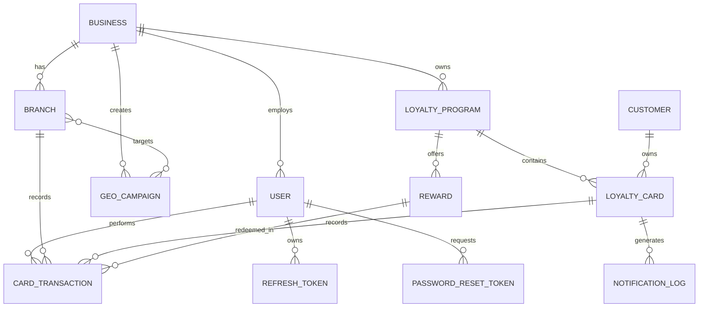
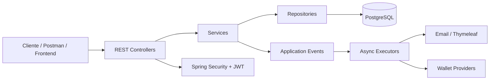
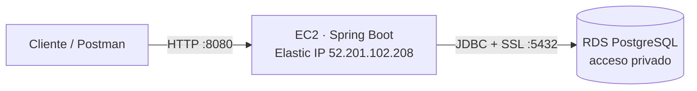

## Fidegresa.GO — Backend
> **CS 2031 · Desarrollo Basado en Plataforma**  
> **Proyecto 1 · Semana 7 — Backend completo**  
> **Equipo:** José Manuel Aguirre · Geannyra Cortez · Jennifer Patiño
>
> **Repositorio:** [https://github.com/Jmanolo2004/DBP-repo-finalroad](https://github.com/Jmanolo2004/DBP-repo-finalroad)  
> **API publicada (Render + Neon, HTTPS):** [https://fidegresa-api.onrender.com/api/v1](https://fidegresa-api.onrender.com/api/v1/health)  
> **Web:** [https://frontendfidegresa.vercel.app](https://frontendfidegresa.vercel.app)  

---

## Proyecto 2 · Backend conectado a la web y a la app de caja

Esta versión reemplaza los datos de demostración del frontend: la web y la app móvil leen y guardan todo en PostgreSQL.

Está publicado en **Render** (backend) y **Neon** (PostgreSQL), con HTTPS. Los pasos están en [DEPLOY.md](DEPLOY.md).

### Equipo y participación

| Integrante | Principales aportes | Participación |
|---|---|---|
| **José Manuel Aguirre Jiménez** | Backend del Proyecto 1 (entidades, seguridad JWT, excepciones, eventos y correo), GitHub Actions y deployment del Proyecto 1 en AWS (EC2 + RDS). | 100 % |
| **Geannyra Cortez** | Pantallas del frontend que consumen esta API: login, registro, métricas, tarjetas y geolocalización. | 100 % |
| **Jennifer Patiño** | Backend con datos reales del Proyecto 2: locales, clientes, programas con reglas por tipo, caja (sellos, cashback, niveles y gift card), métricas, reseñas, equipo, geolocalización, aislamiento por negocio, variables de entorno, 31 pruebas automáticas y deployment del Proyecto 2 (Docker en Render, PostgreSQL en Neon, UptimeRobot). | 100 % |

### Cómo correrlo en local

1. Base de datos (requiere Docker):
   ```bash
   docker compose up -d
   ```
2. Backend (Java 21):
   ```bash
   DB_USERNAME=fidegresa DB_PASSWORD=fidegresa_local JWT_SECRET=una-clave-larga-de-al-menos-32-caracteres mvn spring-boot:run
   ```
   La primera vez carga una cuenta de prueba: `maria@fidegresa.com` · `Fidegresa2026`.
3. Pruebas automáticas (usan H2 en memoria, no necesitan PostgreSQL):
   ```bash
   mvn verify
   ```

### Variables de entorno

| Variable | Para qué sirve | Valor local por defecto |
|---|---|---|
| `DB_URL` | Conexión JDBC a PostgreSQL | `jdbc:postgresql://localhost:5432/fidegresa_db` |
| `DB_USERNAME` / `DB_PASSWORD` | Usuario y contraseña de la base | usuario del sistema / vacío |
| `JWT_SECRET` | Clave para firmar los JWT (mínimo 32 caracteres) | clave temporal al iniciar |
| `JWT_EXPIRATION_MINUTES` / `JWT_REFRESH_DAYS` | Duración del token y del refresh token | 30 / 14 |
| `CORS_ALLOWED_ORIGINS` | Dominios que pueden llamar a la API (ej. la URL de Vercel) | localhost |
| `SEED_DEMO` / `SEED_EMAIL` / `SEED_PASSWORD` | Cuenta de prueba que se crea si no existe | `true` / `maria@fidegresa.com` / `Fidegresa2026` |
| `MAIL_USERNAME` / `MAIL_PASSWORD` | Correo de bienvenida y envío de prueba de audiencias (opcional) | vacío: no se envía |
| `PORT` | Puerto HTTP | 8080 |

Ninguna contraseña ni clave queda escrita en el código.

### Módulos y endpoints (todos bajo `/api/v1`)

| Módulo | Endpoints |
|---|---|
| Autenticación | `POST /auth/login`, `/auth/register`, `/auth/refresh`, `/auth/logout`, `GET /auth/me` |
| Locales | `GET/POST /branches`, `PUT /branches/{id}`, `PATCH /branches/{id}/status`, `PATCH /branches/{id}/position` |
| Clientes | `GET /customers` (paginado, búsqueda, filtro, orden), `GET /customers/stats`, `GET /customers/{id}`, `POST /customers` |
| Programas | `GET/POST /loyalty-programs`, `GET/PUT/DELETE /loyalty-programs/{id}`, `PATCH .../status`, `POST .../duplicate`, `GET .../customers` (paginado) |
| Caja (app móvil) | `GET /cards/qr/{token}`, `POST /cards/{id}/stamps`, `/redemptions`, `/purchases`, `/balance-charges`, `PATCH /cards/{id}/status`, `GET /cards/{id}/transactions`, `GET /transactions`, `DELETE /transactions/{id}` |
| Métricas | `GET /metrics`, `/metrics/overview`, `/metrics/activity`, `/metrics/cohorts`, `/metrics/insights`, `/metrics/export`, `/metrics/profitability` |
| Reportes (solo administradores) | `GET /reports/transactions` (paginado), `GET /reports/transactions/export?format=csv\|xlsx`, `GET /reports/rewards` |
| Webhooks (solo administradores) | `GET/POST/DELETE /webhooks`, `GET /webhooks/secret`, `POST /webhooks/test`, `GET /webhooks/deliveries` (paginado) |
| Reseñas | `GET /reviews` (paginado), `GET /reviews/summary`, `PATCH /reviews/{id}/reply` |
| Geolocalización | `GET /geo/customers`, `GET/PATCH /geo/settings`, `/audiences` (CRUD, vista previa, estado, prueba, duplicar) |
| Equipo | `GET/POST /team`, `PUT/DELETE /team/{id}` |
| Configuración | `GET/PATCH /settings`, `POST /settings/reset`, `GET /notices`, `POST /subscription/upgrade`, `DELETE /account` |

### Webhooks

El backend envía un POST JSON a la URL del negocio cuando ocurre `redemption.created`, `purchase.created` o `transaction.voided` (y `webhook.test` desde el panel). Cabeceras:

- `X-Fidegresa-Signature`: `sha256=` + HMAC-SHA256 en hexadecimal del cuerpo exacto, con el secreto completo como clave.
- `X-Fidegresa-Event`: nombre del evento.
- `X-Fidegresa-Delivery`: identificador del evento; se repite en los reintentos para descartar duplicados.

Una respuesta 2xx confirma la entrega. Si falla, se reintenta al minuto, a los 5 y a los 15 minutos.

Cada negocio solo ve sus propios datos: todas las consultas se filtran por el negocio del usuario autenticado.

---

## Índice

1. [Introducción](#1-introducción)
2. [Problema y justificación](#2-problema-y-justificación)
3. [Solución: funcionalidades y tecnologías](#3-solución-funcionalidades-y-tecnologías)
4. [Modelo de entidades](#4-modelo-de-entidades)
5. [Arquitectura](#5-arquitectura)
6. [Manejo de errores](#6-manejo-de-errores)
7. [Seguridad](#7-seguridad)
8. [Eventos y asincronía](#8-eventos-y-asincronía)
9. [GitHub & Management](#9-github--management)
10. [Conclusión](#10-conclusión)
11. [Apéndices](#11-apéndices)
12. [Criterios cubiertos por la rúbrica](#12-criterios-cubiertos-por-la-rúbrica)

---

## 1. Introducción

Fidegresa.GO es una plataforma SaaS de fidelización que permite a los comercios administrar programas de puntos o sellos mediante tarjetas digitales compatibles con Apple Wallet y Google Wallet. El backend centraliza la administración de negocios, sucursales, trabajadores, clientes, tarjetas, recompensas, campañas de proximidad y métricas.

El objetivo es ofrecer una solución segura y organizada para gestionar la fidelización de clientes. El backend expone una API REST versionada bajo `/api/v1`, utiliza PostgreSQL y aplica una arquitectura Controller → Service → Repository.

El proyecto cumple los criterios técnicos de la rúbrica: más de seis entidades, DTOs especializados, excepciones globales, JWT con refresh tokens, roles, eventos y asincronía, deployment en AWS y documentación.

---

## 2. Problema y justificación

Los programas tradicionales de fidelización pueden depender de tarjetas físicas, registros manuales o procesos poco integrados. Esto dificulta administrar recompensas, historial y operaciones entre sucursales.

Fidegresa.GO centraliza esta gestión: el comercio configura sus programas y los clientes se registran mediante QR y utilizan una tarjeta digital. Los cajeros registran sellos y canjes, mientras los administradores gestionan sucursales, trabajadores, campañas y métricas.

La solución también contempla GeoPush. El backend almacena las coordenadas de las sucursales y la información de las campañas para incorporarlas a los pases digitales. De esta manera, el sistema operativo puede mostrar el aviso de proximidad cuando el cliente se encuentra cerca de una ubicación configurada.

---

## 3. Solución: funcionalidades y tecnologías

### Funcionalidades principales

- Registro, login, refresh y logout mediante JWT.
- Recuperación y restablecimiento de contraseña.
- Gestión de negocios y sucursales.
- Gestión de cajeros y asignación de sucursales.
- Creación y administración de programas de fidelización.
- Creación y administración de recompensas.
- Inscripción pública de clientes mediante QR.
- Creación y consulta de tarjetas de fidelización.
- Registro de sellos y canjes.
- Historial de transacciones.
- Campañas GeoPush asociadas a sucursales.
- Métricas resumidas por período y sucursal.
- Integración con Google Wallet y una interfaz para Apple Wallet.
- Correos HTML mediante plantillas.
- Procesamiento asíncrono de correos, Wallet, notificaciones y auditoría.

### Tecnologías

- Java 21
- Spring Boot 3
- Spring Data JPA
- PostgreSQL
- Spring Security
- JWT
- MapStruct
- Lombok
- Bean Validation
- Spring Mail + Thymeleaf
- Spring Events + `@Async`
- Swagger / OpenAPI
- JUnit 5 + Mockito
- Testcontainers
- JaCoCo
- GitHub Actions
- AWS EC2 + RDS PostgreSQL + Elastic IP

Las credenciales y secretos del entorno productivo se manejan mediante variables de entorno en el servidor (ver [11.2](#112-variables-de-entorno)). El archivo `.env`, certificados y contraseñas reales no deben formar parte del repositorio.

---

## 4. Modelo de entidades

El modelo contempla 12 entidades principales:

| Entidad | Propósito |
|---|---|
| `User` | Usuarios del panel: ADMIN, BRAND_ADMIN y CASHIER. |
| `Business` | Comercio que utiliza la plataforma. |
| `Branch` | Sucursal con coordenadas para GeoPush. |
| `LoyaltyProgram` | Reglas, meta y diseño del programa. |
| `Reward` | Premio canjeable del programa. |
| `Customer` | Consumidor final registrado mediante QR. |
| `LoyaltyCard` | Tarjeta digital con serial, QR, saldo, plataforma y estado. |
| `CardTransaction` | Historial de sellos y canjes. |
| `GeoCampaign` | Campaña de proximidad con vigencia. |
| `RefreshToken` | Token de refresco rotado y revocable. |
| `PasswordResetToken` | Token temporal para recuperación de contraseña. |
| `NotificationLog` | Registro de correos y sincronizaciones enviadas. |

Relaciones relevantes: un `Business` posee sucursales, programas y usuarios; un `LoyaltyProgram` posee recompensas y tarjetas; un `Customer` puede tener varias tarjetas, pero una sola tarjeta por programa; una tarjeta registra sus transacciones; y una campaña puede estar relacionada con múltiples sucursales.

Se utilizan relaciones JPA con `LAZY` explícito en `@ManyToOne`, `mappedBy` en las colecciones y `cascade` únicamente donde existe composición. Las consultas de detalle pueden utilizar `EntityGraph` o `JOIN FETCH` para evitar problemas N+1. Se incluyen constraints e índices para datos como email, QR token, serial y fechas de transacciones.

### Diagrama ER



Los nombres del código se mantienen en inglés para cumplir las convenciones indicadas por la rúbrica.

---

## 5. Arquitectura

El backend sigue una arquitectura por capas y organiza el código por módulos de dominio. Cada módulo puede contener `controller`, `service`, `repository`, `dto`, `mapper`, `entity` y `event`.



Los controllers reciben y validan las solicitudes, delegan el caso de uso al servicio y retornan `ResponseEntity`. No acceden directamente a repositorios ni contienen lógica de negocio. Los servicios mantienen responsabilidades específicas por dominio y las dependencias se inyectan mediante constructor.

Los DTOs separan los datos de entrada y salida de las entidades JPA. Se utilizan mappers, evitando exponer contraseñas, refresh tokens o credenciales internas de Wallet.

---

## 6. Manejo de errores

El sistema utiliza una excepción base `ApiException` con su correspondiente `HttpStatus`. Entre las excepciones personalizadas se encuentran:

- `ResourceNotFoundException` — 404
- `DuplicateResourceException` — 409
- `InvalidOperationException` — 400
- `UnauthorizedException` — 401
- `ForbiddenOperationException` — 403
- `InvalidTokenException` — 401
- `InsufficientStampsException` — 409
- `CardInactiveException` — 409
- `DuplicateScanException` — 409
- `WalletIntegrationException` — 500

Un `@RestControllerAdvice` centraliza las respuestas y también maneja errores de Spring como `MethodArgumentNotValidException`, `ConstraintViolationException`, `HttpMessageNotReadableException`, `MethodArgumentTypeMismatchException`, `AccessDeniedException` y `DataIntegrityViolationException`.

El formato común es:

```json
{
  "timestamp": "2026-09-25T12:00:00",
  "status": 409,
  "error": "Conflict",
  "message": "Resource already exists",
  "path": "/api/v1/...",
  "fieldErrors": {}
}
```

Los errores generados antes de llegar al controller por el filtro JWT se manejan mediante `AuthenticationEntryPoint` para 401 y `AccessDeniedHandler` para 403, manteniendo el mismo formato de respuesta.

---

## 7. Seguridad

La API utiliza Spring Security con arquitectura stateless y JWT. El flujo contempla:

1. Registro con email único y validación de password strength.
2. Hash de contraseñas mediante BCrypt.
3. Login para generar access token y refresh token.
4. `JwtAuthenticationFilter` para leer `Authorization: Bearer`.
5. `JwtService` para generar y validar tokens.
6. `UserDetailsService` personalizado para buscar usuarios.
7. Refresh tokens almacenados en PostgreSQL, rotados en cada uso y revocados al cerrar sesión.
8. Secret JWT únicamente mediante variable de entorno.
9. Access token de corta duración y refresh token de mayor duración.
10. `@PreAuthorize` en operaciones sensibles.
11. Uso de `SecurityContext` desde los servicios para aislar información por negocio.
12. CORS configurado mediante orígenes permitidos en variables de entorno.

Los tres roles son `ADMIN`, `BRAND_ADMIN` y `CASHIER`. El administrador de marca gestiona su comercio, programas, sucursales, cajeros y métricas; el cajero puede operar únicamente sobre las sucursales que tiene asignadas; y el administrador de plataforma administra los negocios.

Las rutas públicas se limitan a autenticación, inscripción pública, Swagger y health check. La validación mediante DTOs y JPA constraints ayuda a prevenir entradas inválidas e inyección de datos, mientras que el diseño stateless permite desactivar CSRF al no utilizar autenticación basada en cookies.

---

## 8. Eventos y asincronía

La aplicación utiliza eventos personalizados para desacoplar operaciones principales de tareas secundarias. Los eventos definidos son:

- `BusinessRegisteredEvent`
- `CustomerEnrolledEvent`
- `StampAddedEvent`
- `RewardUnlockedEvent`
- `RewardRedeemedEvent`
- `GeoCampaignActivatedEvent`
- `PasswordResetRequestedEvent`

Los eventos se publican mediante `ApplicationEventPublisher`; sus listeners utilizan `@TransactionalEventListener(phase = AFTER_COMMIT)` y `@Async`. Así, la operación principal no depende de servicios externos y no se envía correo si la transacción hace rollback.

La configuración asíncrona utiliza `@EnableAsync` y `ThreadPoolTaskExecutor`, con ejecutores diferenciados para correo y Wallet. Por ejemplo, al registrar un sello, la respuesta al cajero puede finalizar rápidamente mientras se actualiza el pase, se registra auditoría o se envía una notificación.

El correo utiliza `JavaMailSender` y plantillas Thymeleaf para bienvenida, tarjeta emitida, premio desbloqueado, canje confirmado y recuperación de contraseña. Los fallos se registran en `NotificationLog` y no deben provocar el fallo de la operación principal.

---

## 9. GitHub & Management

El proyecto utiliza GitFlow con las ramas principales `main` y `develop`, además de ramas `feature/*` y `fix/*`. Los cambios se integran mediante Pull Requests, con revisión de otro integrante y CI en verde antes del merge.

GitHub Projects organiza el trabajo mediante:

`Backlog → To do → In progress → In review → Done`

Cada tarea se registra como Issue con responsable y fecha. Se utilizan labels como `feature`, `security`, `bug`, `devops`, `docs` y `test`, además de milestones por fase.

GitHub Actions ejecuta CI en cada push y Pull Request: compila el proyecto con Maven y ejecuta las pruebas. El despliegue a producción se realiza en AWS EC2 (ver [11.5](#115-deployment-en-aws)).

---

## 10. Conclusión

Fidegresa.GO propone un backend completo para administrar programas de fidelización mediante tarjetas digitales y QR. La solución integra la administración de comercios, sucursales, cajeros, programas, clientes, tarjetas, recompensas, transacciones y campañas.

El desarrollo aplica persistencia con JPA, arquitectura por capas, DTOs, excepciones globales, JWT, autorización por roles, eventos, asincronía y despliegue cloud en AWS.

Entre los principales aprendizajes se encuentran la importancia de separar responsabilidades, proteger los datos sensibles, utilizar correctamente los códigos HTTP y desacoplar procesos externos mediante eventos asíncronos.

Como trabajo futuro se puede ampliar la integración con proveedores de Wallet, incorporar almacenamiento de logos mediante S3, automatizar el despliegue con GitHub Actions y continuar fortaleciendo métricas, pruebas y observabilidad.

---

## 11. Apéndices

### 11.1 Ejecución local

Requisitos:

- Java 21
- Maven 3.8+
- PostgreSQL 15+ con una base de datos creada (por ejemplo `fidegresa_db`)

Configurar la conexión en `src/main/resources/application.properties` o mediante las variables de entorno de la sección 11.2, y ejecutar:

```bash
mvn spring-boot:run
```

Para compilar y ejecutar las pruebas:

```bash
mvn clean verify
```

### 11.2 Variables de entorno

Spring Boot reemplaza automáticamente cualquier propiedad de `application.properties` por una variable de entorno con el mismo nombre en mayúsculas y con `_` (por ejemplo, `spring.datasource.url` → `SPRING_DATASOURCE_URL`). Así, el mismo código funciona en local y en AWS sin modificaciones.

Variables utilizadas en producción:

```text
SPRING_DATASOURCE_URL=jdbc:postgresql://<endpoint-rds>:5432/finalroad?sslmode=require
SPRING_DATASOURCE_USERNAME=
SPRING_DATASOURCE_PASSWORD=
SPRING_MAIL_USERNAME=
SPRING_MAIL_PASSWORD=
```

Nunca subir `.env`, certificados ni credenciales reales al repositorio.

### 11.3 Endpoints principales

Todas las rutas están versionadas bajo `/api/v1`.

| Método | Endpoint | Descripción | Auth |
|---|---|---|---|
| POST | `/api/v1/auth/register` | Registrar usuario asociado a un negocio | Pública |
| POST | `/api/v1/auth/login` | Iniciar sesión (devuelve JWT) | Pública |
| GET | `/api/v1/auth/me` | Datos del usuario autenticado | Bearer token |
| — | `/api/v1/businesses` | Gestión de negocios | Bearer token |
| — | `/api/v1/customers` | Gestión de clientes | Bearer token |
| — | `/api/v1/loyalty-programs` | Gestión de programas de fidelización | Bearer token |

La colección de Postman se encuentra en la carpeta [`postman/`](postman/) del repositorio.

### 11.4 Equipo

| Integrante | Responsabilidad |
|---|---|
| **Manuel Aguirre** | Seguridad, usuarios, JWT, autenticación, excepciones y coordinación comercial/técnica |
| **Geannyra Cortez** | Business, Branch, Program, Reward, Customer, Card, sellos, canjes y métricas |
| **Jennifer Patiño** | Eventos, asincronía, correo, Wallet, GeoPush y auditoría |
| **Jossue Caceres** | CI/CD, AWS, tests, JaCoCo, Swagger, Postman y despliegue |

### 11.5 Deployment en AWS

La API está desplegada en AWS (AWS Academy Learner Lab):

| Recurso | Valor |
|---|---|
| **URL base** | [http://52.201.102.208:8080/api/v1](http://52.201.102.208:8080/api/v1) |
| **Swagger** | [http://52.201.102.208:8080/swagger-ui/index.html](http://52.201.102.208:8080/swagger-ui/index.html) |

#### Arquitectura de despliegue

| Componente | Servicio | Detalle |
|---|---|---|
| Servidor | Amazon EC2 | Amazon Linux 2023, `t3.small`, Java 21 (Amazon Corretto) |
| Base de datos | Amazon RDS | PostgreSQL 18, `db.t4g.micro`, sin acceso público |
| IP fija | Elastic IP | `52.201.102.208` |
| Región | `us-east-1` | Norte de Virginia |



#### Seguridad de red

- **RDS** no tiene acceso público. El puerto 5432 solo acepta conexiones desde el Security Group de la instancia EC2 (`ec2-rds-1` → `rds-ec2-1`).
- **EC2** (`backend-sg`) expone el puerto **8080** para la API y el **22** para administración mediante EC2 Instance Connect.
- La conexión entre la API y la base de datos usa **SSL** (`sslmode=require`).
- Las credenciales de la base de datos se configuran en el servidor mediante un archivo de variables de entorno con permisos restringidos (`chmod 600`), fuera del repositorio.

#### Proceso de despliegue

1. Instalación de Java 21, Maven y Git en EC2.
2. Clonado del repositorio y compilación con `mvn clean package -DskipTests`.
3. Configuración de variables de entorno en `/etc/fidegresa.env`.
4. Ejecución como servicio `systemd` (`fidegresa.service`), con reinicio automático y arranque junto con el servidor.

Para actualizar la aplicación tras un nuevo push:

```bash
cd ~/DBP-repo-finalroad
git pull
mvn clean package -DskipTests
sudo systemctl restart fidegresa
```

#### Cómo probar

Usar Postman con la variable `base_url = http://52.201.102.208:8080`. Las rutas protegidas requieren el header `Authorization: Bearer <token>`.

El registro requiere un negocio existente (`businessId`). En el entorno desplegado existe el negocio de demostración **Fidegresa Demo** con `id = 1`.

```http
POST /api/v1/auth/register
Content-Type: application/json

{
  "email": "usuario@ejemplo.com",
  "password": "MiPassword123$",
  "businessId": 1
}
```

Flujo sugerido: **Register** (201) → **Login** (200, devuelve token) → **Me** con Bearer token (200).

> **Nota:** el despliegue corre en AWS Academy Learner Lab, por lo que el servidor solo está disponible mientras el laboratorio esté activo. Al iniciar el laboratorio, la instancia y la base de datos se encienden y la API arranca automáticamente.


### 11.6 Licencia

Este proyecto se distribuye bajo la licencia: **MIT**.

### 11.7 Referencias

- Documentación oficial de Spring Boot y Spring Security.
- Documentación de Spring Data JPA.
- Documentación de PostgreSQL.
- Documentación de AWS EC2 y Amazon RDS.
- Documentación de Google Wallet API.
- Documentación de Apple Wallet / PassKit.
- Documentación de Swagger / OpenAPI.
- Material y rúbrica del curso CS 2031 — Desarrollo Basado en Plataforma.

---

## 12. Criterios cubiertos por la rúbrica

| Criterio | Evidencia en el proyecto |
|---|---|
| Entidades | 12 entidades, relaciones JPA, constraints e índices |
| DTOs | DTOs especializados para requests, updates, responses y detalles |
| Arquitectura | Controller → Service → Repository y separación por dominio |
| SRP | Servicios y métodos pequeños con responsabilidades específicas |
| Excepciones | 10 excepciones propias + `@RestControllerAdvice` |
| Seguridad | Spring Security, JWT, refresh tokens, BCrypt, CORS y roles |
| REST | `/api/v1`, recursos plurales y códigos HTTP apropiados |
| Eventos | 7 eventos con listeners transaccionales |
| Async | `@Async` + `ThreadPoolTaskExecutor` |
| Email | JavaMailSender + Thymeleaf + manejo asíncrono |
| Deployment | AWS EC2 + RDS PostgreSQL + Elastic IP, servicio `systemd`, evidencias en [11.5](#115-deployment-en-aws) |
| Git | GitFlow, PRs, reviews y CI con GitHub Actions |
| Management | GitHub Projects, Issues, labels y milestones |
| Bonus | Swagger, logging, paginación, filtros y tests |


#### Evidencias de pruebas

**Funcionamiento de RDS y EC2 en AWS**


